**🟢 Available for freelance projects & remote work**

  

## The tools behind the work.

**Backend & Data** 

**Frontend & Interfaces** 

**Workflow & Tooling** 

 

  

**[mohanadabusbib@gmail.com](mailto:mohanadabusbib@gmail.com)** · Telegram [@mohanadabusbib](https://t.me/mohanadabusbib)

